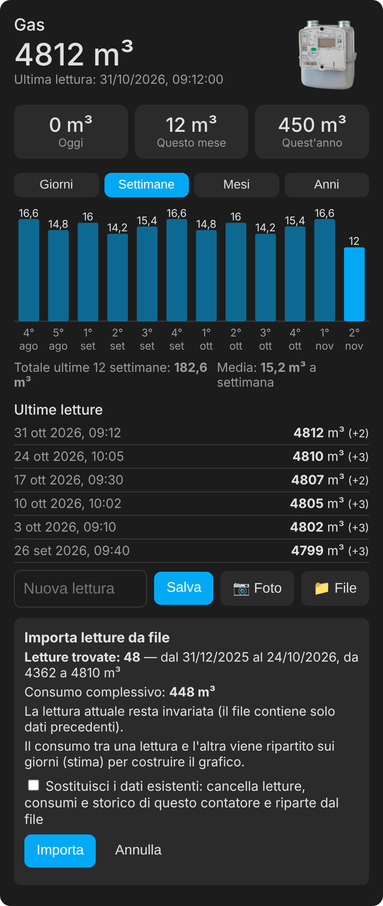
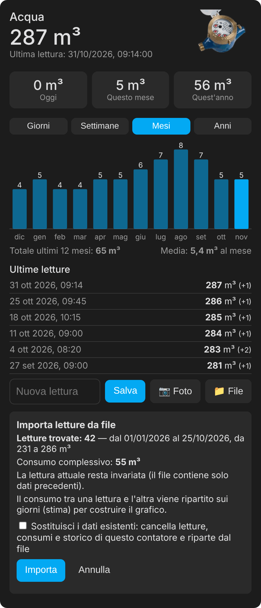

# Rilevatore consumi gas / acqua (v2.2.1)

🇮🇹 Italiano · 🇬🇧 [English](README.md)

<p align="center">
  
  &nbsp;&nbsp;
  
</p>

---

Integrazione per Home Assistant per registrare la lettura del **contatore del gas** e dell'**acqua** (m³ interi), vederla nella **plancia Energia** e calcolare i consumi di oggi, del mese e dell'anno. Pensata per chi non può installare sensori vicino ai contatori: la lettura si inserisce **a mano**, **da foto**, oppure **da CSV**.

Richiede Home Assistant **2025.10 o successivo**.

### Installazione

**HACS** (consigliato): apri HACS, cerca **Rilevatore consumi**, scaricalo e riavvia Home Assistant.
**HACS, come repository personalizzato** (alternativa, per esempio se non lo trovi nella ricerca): Integrazioni → menu ⋮ → *Repository personalizzati* → `https://github.com/stefanodr/Rilevatore-gas-acqua` (categoria *Integrazione*) → installa → riavvia.
**Manuale**: copia `custom_components/rilevatore_consumi` nella cartella `custom_components` di HA e riavvia.

### Configurazione

*Impostazioni → Dispositivi e servizi → Aggiungi integrazione → Rilevatore consumi.* Aggiungi un contatore per il gas e uno per l'acqua, indicando nome, tipo e lettura attuale (solo la parte intera).

Per ogni contatore ottieni:
- **Lettura contatore** (da usare nella plancia Energia come fonte gas/acqua);
- **Consumo oggi / mese / anno**;
- **Nuova lettura** (campo numerico) e **Ultima foto** (solo in memoria, mai salvata su disco).

### Inserire la lettura

- **A mano**: card, entità *Nuova lettura* o servizio `rilevatore_consumi.set_reading`.
- **Da CSV**: con la card tocca 📁 *File*, controlla l'anteprima e conferma. Serve per caricare più letture in blocco, per portare lo storico su una nuova installazione e per ripristinare i contatori (vedi [Ripristinare contatori e totali](#ripristino)).
- **Da foto**: con la card tocca 📷, scatta, controlla il valore proposto e conferma. Richiede un'entità **AI Task** (es. Google Gemini, oppure Ollama in locale se non vuoi inviare foto a servizi esterni). Nelle opzioni dell'integrazione puoi scegliere quale usare. Il valore è sempre solo un suggerimento: **non viene salvato senza la tua conferma**.

Controlli: una lettura più bassa viene rifiutata (se hai sostituito il contatore, conferma "contatore sostituito"); un aumento oltre la soglia (300 m³ gas, 100 m³ acqua, modificabile) va confermato.

### Card

Dopo l'installazione la risorsa è registrata da sola. Aggiungi una **scheda manuale**:

```yaml
type: custom:rilevatore-consumi-card
meter: gas        # gas oppure water: la card trova da sola il sensore giusto
title: Gas        # facoltativo
```

La card mostra la lettura, i consumi di oggi / del mese / dell'anno, il grafico a barre degli ultimi 30 giorni, 12 mesi e 5 anni (con media e totale), le ultime letture e i comandi per inserire la lettura a mano o da foto. Il grafico usa le statistiche di Home Assistant, quindi comprende anche lo storico recuperato dal vecchio sensore. In alternativa a `meter` puoi indicare `entity: sensor.…` (il sensore "Lettura contatore").

Se vuoi, aggiungi `image: /local/mia-foto.png` per usare un'altra immagine del contatore, oppure `image: false` per nasconderla: di serie in alto a destra compare l'immagine del gas o dell'acqua.

### Importare letture e storico da file

Nella card, il pulsante **📁 File** carica un file CSV con le letture. Vengono accettati l'esportazione della cronologia di Home Assistant (`entity_id,state,last_changed`) e file semplici con data e lettura (`data;lettura`, con date ISO o `gg/mm/aaaa [hh:mm]`, separatore `,` `;` o tabulazione, decimali ignorati). Prima di scrivere qualsiasi cosa vedi un'**anteprima** (letture trovate, periodo, consumo complessivo, eventuali diminuzioni o righe ignorate) e confermi.

Con l'importazione:
- le letture entrano nell'elenco delle ultime letture e nei consumi di oggi/mese/anno;
- la lettura attuale cambia solo se il file contiene una lettura più recente e non più bassa;
- le statistiche del grafico vengono ricostruite ripartendo il consumo tra una lettura e l'altra (è una stima giorno per giorno; i totali restano esatti). Si riempie il periodo precedente ai dati già presenti, senza toccare quelli esistenti; ripetere l'importazione non duplica nulla.

È il modo più semplice anche per caricare nuove letture in blocco o per portare lo storico dell'acqua e del gas su una nuova installazione.

<a id="ripristino"></a>
### Ripristinare contatori mensile/annuale e totali della plancia Energia

Se «Questo mese» / «Quest'anno» partono da un valore sbagliato (es. dopo una nuova installazione) o la plancia Energia mostra totali errati, ripristina così.

**1. Contatori mensile e annuale corretti.** Il consumo di un periodo è la lettura attuale meno la lettura **a inizio periodo**. Carica un CSV che contenga la lettura del 1° gennaio (per l'anno) e/o del 1° del mese (per il mese):

```
data;lettura
01/01/2026;4362
01/10/2026;4800
```

Dopo l'importazione la card toglie la dicitura «(parziale)» e i valori sono esatti. Con più letture intermedie (anche una al mese) il grafico diventa più preciso. Se hai già un'esportazione della cronologia del vecchio sensore, caricala così com'è.

**2. Totali della plancia Energia.** La plancia usa le statistiche a lungo termine. Per ricostruire il passato carica un CSV con lo storico (il periodo precedente ai dati già presenti viene riempito, quelli esistenti non vengono toccati; ripetere l'importazione non duplica nulla). In alternativa usa il servizio `rilevatore_consumi.import_history` (campo `source`: il vecchio sensore). Se hai già barre negative o totali sballati, esegui una volta `rilevatore_consumi.repair_statistics` sul sensore *Lettura contatore* e attendi circa un'ora che la plancia si aggiorni.

**3. Se usi ancora i contatori `utility_meter` della v1.x.** Puoi correggerli con *Strumenti per sviluppatori → Azioni* e `utility_meter.calibrate`, indicando i **m³ consumati nel periodo corrente** (non la lettura del contatore):

```yaml
action: utility_meter.calibrate
target:
  entity_id: sensor.consumo_mensile_gas
data:
  value: "12"
```

### Se arrivi dalla v1.x (package YAML)

Lo storico della plancia Energia è legato al **nome** del sensore (`sensor.gas_consumption`, `sensor.water_consumption`). Per non perderlo:
1. Backup e annota la lettura attuale.
2. Rimuovi il package YAML (e le viste) e riavvia, fermando HA in modo pulito. **Non** togliere i tuoi helper utility meter creati dall'interfaccia: continueranno a funzionare perché il sensore tornerà ad avere lo stesso nome.
3. In *Impostazioni → Dispositivi e servizi → Entità* elimina il vecchio sensore "non più fornito". Le statistiche restano nel database.
4. Aggiungi l'integrazione con la lettura annotata e, in **Sensore esistente**, `sensor.gas_consumption` / `sensor.water_consumption`: il nuovo sensore ne prende il nome e lo storico continua senza interruzioni.

**Se hai già aggiunto il contatore senza indicare il sensore** (e il sensore ha un altro nome, per esempio `sensor.gas_meter_reading`), non serve rifarlo:
- Opzione A: nelle *opzioni* dell'integrazione indica il vecchio sensore (dopo aver eliminato quello vecchio come al punto 3); l'integrazione lo rinomina e riprende le statistiche.
- Opzione B: in *Strumenti per sviluppatori → Azioni* esegui `rilevatore_consumi.import_history`, scegli come destinazione il sensore "Lettura contatore" e come `source` il vecchio sensore (es. `sensor.gas_consumption`). Le statistiche vecchie vengono copiate sul nuovo sensore, senza buchi nel totale. Poi nella plancia Energia seleziona il nuovo sensore.

Nella cartella `legacy/` trovi la v1.1 (package YAML) per chi preferisce restare così.

### Risoluzione dei problemi

**Barre negative nella plancia Energia** (per esempio −440 m³ nell'ultimo mese, dopo aver importato storico o file con una versione precedente): esegui in *Strumenti per sviluppatori → Azioni* `rilevatore_consumi.repair_statistics` sul sensore "Lettura contatore" di ogni contatore. Il servizio ricalcola le somme dalle letture memorizzate partendo dall'ora più recente e aggiunge in testa una riga di riferimento, necessaria perché la plancia calcoli bene il primo mese dell'anno; si può ripetere senza danni. Dopo l'aggiornamento le importazioni non creano più il problema.

**Le card non si aprono nella Companion app** ("Errore di configurazione" / "Custom element doesn't exist") mentre dal browser funzionano: è un difetto noto dell'app (home-assistant/frontend #55272), che tiene in cache la pagina iniziale e non riceve i moduli aggiunti dalle integrazioni. Registra la card anche come risorsa della dashboard: *Impostazioni → Dashboard → ⋮ → Risorse → Aggiungi risorsa*, URL `/rilevatore_consumi_static/rilevatore-consumi-card.js`, tipo *Modulo JavaScript*. In alternativa svuota la cache dell'app.

### Domande frequenti

**Dopo il download da HACS non vedo l'integrazione.**
Riavvia **Home Assistant** per intero (non solo HACS: *Impostazioni → Sistema → Riavvia*), poi *Impostazioni → Dispositivi e servizi → Aggiungi integrazione* e cerca "Rilevatore consumi". Verifica inoltre che Home Assistant sia 2025.10 o successivo, che il repository sia stato aggiunto con categoria *Integrazione* e che in `/config/custom_components/` esista la cartella `rilevatore_consumi` con dentro `manifest.json` e gli altri file. Se manca, riscarica da HACS; se c'è ma l'integrazione non compare, cerca `rilevatore_consumi` in *Impostazioni → Sistema → Log*.

<a id="ripartire"></a>
**Hai importato un file sbagliato o le letture non sono corrette? Come ripartire da zero.**
Vale per un solo contatore (gas o acqua): l'altro non viene toccato. Serve il CSV **giusto**, con le letture del contatore in m³ interi (non i consumi). Reinstallare l'integrazione **non** cancella le statistiche: usa questa procedura (dalla v2.1.4).

1. **Cancella da Azioni (pochi secondi).** In *Strumenti per sviluppatori → Azioni* scegli `rilevatore_consumi.reset_history`, come entità il sensore «Lettura contatore» del contatore da azzerare, attiva `confirm` ed esegui. `reading` è **facoltativo**: lascialo vuoto e la lettura attuale verrà presa dall'ultima riga del CSV che importi dopo; indicalo solo se vuoi impostare subito una lettura precisa.
2. **Controlla che sia finito.** L'azione termina senza errori e nella risposta elenca i sensori puliti (`cleared`); se segnala che l'azzeramento non è completo (`reset_incomplete`), eseguila di nuovo. Vengono cancellati letture, consumi, statistiche (grafici e plancia Energia) e cronologia di quel contatore. Non serve aspettare l'aggiornamento dei grafici (può richiedere fino a un'ora).
3. **Carica il file giusto dalla card.** Tocca 📁 *File*, controlla l'anteprima e conferma (non spuntare «Sostituisci»: hai già azzerato). Con molti anni di storico servono anche **10-15 minuti**: puoi lasciare o ricaricare la pagina, l'importazione continua da sola. **Aspetta la notifica** in Home Assistant (campanella): «importate N letture; storico dei grafici ricostruito». Finché non arriva non è finita. Se dice «importazione NON completata», ripeti la stessa importazione: completa la parte mancante.
4. **Verifica** la card (Giorni / Mesi / Anni) e la plancia Energia. Non serve `repair_statistics`: la riparazione delle somme è automatica a fine importazione.

Se importi un file senza azzerare prima, viene riempito solo il periodo **precedente** ai dati già presenti, quindi i valori sbagliati restano. In alternativa, la casella **«Sostituisci i dati esistenti»** nell'anteprima fa le stesse operazioni in un'unica richiesta, più lunga e senza il controllo intermedio. Con versioni precedenti alla 2.1.4 aggiorna prima.

**Con la Companion app Android il pulsante 📷 permette solo di scegliere una foto già scattata.**
L'app non ha il permesso Fotocamera (non compare nelle autorizzazioni del telefono), quindi lo scatto diretto non è disponibile. Scatta la foto con la fotocamera del telefono e poi scegli l'ultima dalla galleria con 📷 (il valore va comunque confermato), oppure apri Home Assistant in Chrome, che chiede il permesso e apre direttamente la fotocamera. Dalla v2.1.1, se dopo lo scatto la pagina si ricarica da sola, la card recupera il risultato della foto o avvisa che non è arrivata.

**Posso importare il file dell'acqua e quello del gas insieme?**
Sì, sono contatori indipendenti e non si disturbano. Per lo stesso contatore invece l'importazione parte una alla volta: una seconda viene rifiutata finché la prima non finisce. L'importazione di anni di letture può richiedere alcuni minuti: la card mostra "importazione in corso" e a fine lavoro compare una notifica in Home Assistant. Se un'importazione si interrompe, ripeti la stessa operazione: completa la parte mancante.

### Servizi

- `rilevatore_consumi.set_reading` — `reading`, `force`, `replace_meter`
- `rilevatore_consumi.read_from_photo` — `media` (restituisce la proposta, non salva)
- `rilevatore_consumi.import_history` — `source` (copia le statistiche di un vecchio sensore)
- `rilevatore_consumi.repair_statistics` — toglie i salti nelle somme dello storico
- `rilevatore_consumi.reset_history` — `confirm`, `reading` (facoltativa): **cancella in un solo passaggio** letture, consumi di mese/anno e statistiche del contatore; non si può annullare, da eseguire sul sensore "Lettura contatore"
