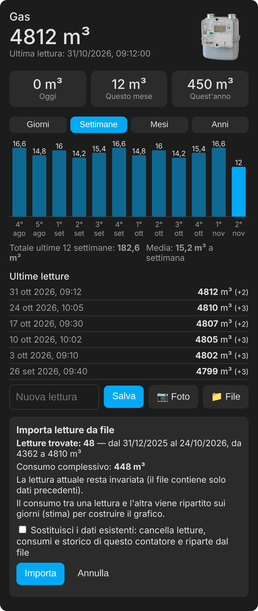
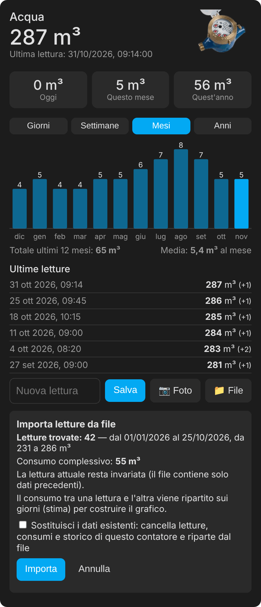

# Gas / water meter reader (v2.2.0)

🇬🇧 English · 🇮🇹 [Italiano](README.it.md)

<p align="center">
  
  &nbsp;&nbsp;
  
</p>

---

Home Assistant integration to record the **gas** and **water meter** reading (whole m³), show it in the **Energy dashboard** and compute today / month / year consumption. Built for meters where no sensor can be installed: enter the reading **by hand** or **by photo**, or **from CSV**.

Requires Home Assistant **2025.10 or later**.

### Installation

**HACS**: Integrations → ⋮ → *Custom repositories* → `https://github.com/stefanodr/Rilevatore-gas-acqua` (type *Integration*) → install → restart.
**Manual**: copy `custom_components/rilevatore_consumi` into HA's `custom_components` folder and restart.

### Setup

*Settings → Devices & services → Add integration → Rilevatore consumi.* Add one gas and one water meter with name, type and current reading (integer part only).

Each meter provides:
- **Meter reading** (use it as gas/water source in the Energy dashboard);
- **Consumption today / month / year**;
- **New reading** (number field) and **Last photo** (kept in memory only, never written to disk).

### Entering a reading

- **By hand**: the card, the *New reading* entity or the `rilevatore_consumi.set_reading` service.
- **From CSV**: in the card tap 📁 *File*, check the preview and confirm. Use it to load many readings at once, to bring history into a new installation and to restore the counters (see [Restoring counters and totals](#restore)).
- **From a photo**: in the card tap 📷, take the picture, check the proposed value and confirm. Needs an **AI Task** entity (e.g. Google Gemini, or local Ollama if you don't want photos sent to external services). You can choose which one in the integration options. The value is only a suggestion: **nothing is saved without your confirmation**.

Checks: a lower reading is rejected (if you replaced the meter, confirm "meter replaced"); an increase above the threshold (300 m³ gas, 100 m³ water, configurable) must be confirmed.

### Card

The resource is registered automatically. Add a **manual card**:

```yaml
type: custom:rilevatore-consumi-card
meter: gas        # gas or water: the card finds the right sensor by itself
title: Gas        # optional
```

The card shows the reading, consumption today / this month / this year, a bar chart of the last 30 days, 12 months and 5 years (with total and average), the latest readings and the controls to enter a reading by hand or from a photo. The chart uses Home Assistant statistics, so it includes history recovered from the old sensor. Instead of `meter` you can use `entity: sensor.…` (the "Meter reading" sensor).

Add `image: /local/my-photo.png` to use another picture of the meter, or `image: false` to hide it: by default a gas or water meter picture appears at the top right.

### Importing readings and history from a file

In the card, the **📁 File** button uploads a CSV file of readings. Accepted: the Home Assistant history export (`entity_id,state,last_changed`) and simple files with a date and a reading (`date;reading`, ISO dates or `dd/mm/yyyy [hh:mm]`, separator `,` `;` or tab, decimals ignored). Before anything is written you see a **preview** (readings found, period, total consumption, any decreases or ignored rows) and you confirm.

On import:
- readings go into the latest-readings list and into today / month / year consumption;
- the current reading changes only if the file holds a newer, not lower reading;
- chart statistics are rebuilt by spreading consumption between readings (a day-by-day estimate; totals stay exact). It fills the period before the data already present, without touching existing data; importing twice does not duplicate anything.

It is also the easiest way to load new readings in bulk or to bring gas and water history into a fresh installation.

<a id="restore"></a>
### Restoring monthly/yearly counters and Energy dashboard totals

If "This month" / "This year" start from a wrong value (e.g. after a fresh install) or the Energy dashboard shows wrong totals, restore them like this.

**1. Correct monthly and yearly counters.** Consumption of a period is the current reading minus the reading **at the start of the period**. Upload a CSV holding the reading of 1 January (for the year) and/or the 1st of the month (for the month):

```
date;reading
01/01/2026;4362
01/10/2026;4800
```

After the import the card drops the "(partial)" label and the values are exact. More intermediate readings (even one per month) make the chart more accurate. If you already have a history export of the old sensor, upload it as it is.

**2. Energy dashboard totals.** The dashboard uses long-term statistics. To rebuild the past, upload a CSV with the history (the period before existing data is filled, existing data is left untouched; importing twice does not duplicate anything). Alternatively use the `rilevatore_consumi.import_history` service (`source` field: the old sensor). If you already have negative bars or wrong totals, run `rilevatore_consumi.repair_statistics` once on the *Meter reading* sensor and wait about an hour for the dashboard to refresh.

**3. If you still use the v1.x `utility_meter` counters.** Fix them from *Developer tools → Actions* with `utility_meter.calibrate`, giving the **m³ consumed in the current period** (not the meter reading):

```yaml
action: utility_meter.calibrate
target:
  entity_id: sensor.consumo_mensile_gas
data:
  value: "12"
```

### Coming from v1.x (YAML package)

Energy dashboard history is tied to the sensor **name** (`sensor.gas_consumption`, `sensor.water_consumption`). To keep it:
1. Back up and note the current reading.
2. Remove the YAML package (and views) and restart, shutting HA down cleanly. Do **not** remove your utility meter helpers created from the UI: they keep working because the sensor gets the same name again.
3. In *Settings → Devices & services → Entities* delete the old "no longer provided" sensor. Its statistics stay in the database.
4. Add the integration with the noted reading and, under **Existing sensor**, `sensor.gas_consumption` / `sensor.water_consumption`: the new sensor takes that name and the history continues without a gap.

**If you already added the meter without the existing sensor** (so it has another name, e.g. `sensor.gas_meter_reading`) there is no need to redo it:
- Option A: in the integration *options* enter the old sensor (after deleting the old one as in step 3); the integration renames itself and picks up the statistics.
- Option B: in *Developer tools → Actions* run `rilevatore_consumi.import_history`, target the "Meter reading" sensor and set `source` to the old sensor (e.g. `sensor.gas_consumption`). The old statistics are copied to the new sensor with no gap in the total. Then select the new sensor in the Energy dashboard.

The `legacy/` folder holds v1.1 (YAML package) for those who prefer it.

### Troubleshooting

**Negative bars in the Energy dashboard** (for example −440 m³ in the last month, after importing history or a file with an earlier version): in *Developer tools → Actions* run `rilevatore_consumi.repair_statistics` on the "Meter reading" sensor of each meter. The service recomputes the sums from the stored readings starting from the most recent hour and adds a reference row at the start, needed for the dashboard to compute the first month of the year correctly; safe to repeat. After the update, imports no longer cause the problem.

**Cards do not open in the Companion app** ("Configuration error" / "Custom element doesn't exist") while they work in the browser: this is a known app issue (home-assistant/frontend #55272): the app caches the start page and does not receive modules added by integrations. Also register the card as a dashboard resource: *Settings → Dashboards → ⋮ → Resources → Add resource*, URL `/rilevatore_consumi_static/rilevatore-consumi-card.js`, type *JavaScript module*. Alternatively clear the app cache.

### FAQ

**After downloading from HACS I can't see the integration.**
Restart **Home Assistant** completely (not only HACS: *Settings → System → Restart*), then *Settings → Devices & services → Add integration* and search for "Rilevatore consumi". Also check that Home Assistant is 2025.10 or later, that the repository was added with the *Integration* category, and that `/config/custom_components/` contains the `rilevatore_consumi` folder with `manifest.json` and the other files. If it is missing, download again from HACS; if it is there but the integration does not show up, search for `rilevatore_consumi` in *Settings → System → Logs*.

<a id="start-over"></a>
**Did you import a wrong file, or are the readings incorrect? How to start from scratch.**
This applies to a single meter (gas or water): the other one is not touched. You need the **correct** CSV, with meter readings in whole m³ (not consumption). Reinstalling the integration does **not** delete the statistics: use this procedure (from v2.1.4).

1. **Delete from Actions (a few seconds).** In *Developer tools → Actions* choose `rilevatore_consumi.reset_history`, pick the "Meter reading" sensor of the meter to reset as the entity, turn `confirm` on and run it. `reading` is **optional**: leave it empty and the current reading will be taken from the last row of the CSV you import next; fill it only if you want to set a specific reading right away.
2. **Check it finished.** The action ends without errors and its response lists the cleaned sensors (`cleared`); if it reports the reset is incomplete (`reset_incomplete`), run it again. Readings, consumption, statistics (charts and Energy dashboard) and sensor history of that meter are deleted. You do not need to wait for the charts to refresh (it can take up to an hour).
3. **Load the correct file from the card.** Tap 📁 *File*, check the preview and confirm (do not tick "Replace": you have already reset). With many years of history it takes up to **10-15 minutes**: you can leave or reload the page, the import keeps running. **Wait for the notification** in Home Assistant (bell): "imported N readings; chart history rebuilt". Until it arrives it is not finished. If it says "import NOT completed", repeat the same import: it completes the missing part.
4. **Check** the card (Days / Months / Years) and the Energy dashboard. You do not need `repair_statistics`: the sums are repaired automatically at the end of the import.

If you import a file without resetting first, only the period **before** the data already present is filled, so the wrong values stay. Alternatively, the **"Replace existing data"** box in the preview does the same operations in a single, longer request without the intermediate check. With versions older than 2.1.4, update first.

**With the Android Companion app the 📷 button only lets me pick an existing photo.**
The app has no Camera permission (it does not appear in the phone's permissions), so direct capture is not available. Take the picture with the phone camera and then pick the latest one from the gallery with 📷 (the value still has to be confirmed), or open Home Assistant in Chrome, which asks for the permission and opens the camera directly. From v2.1.1, if the page reloads by itself after the shot, the card recovers the photo result or tells you it did not arrive.

**Can I import the water file and the gas file at the same time?**
Yes, they are independent meters and do not interfere. For the same meter, instead, imports run one at a time: a second one is refused until the first finishes. Importing years of readings can take a few minutes: the card shows "import in progress" and at the end a notification appears in Home Assistant. If an import is interrupted, repeat the same operation: it completes the missing part.

### Services

- `rilevatore_consumi.set_reading` — `reading`, `force`, `replace_meter`
- `rilevatore_consumi.read_from_photo` — `media` (returns the proposal, saves nothing)
- `rilevatore_consumi.import_history` — `source` (copies the statistics of an old sensor)
- `rilevatore_consumi.repair_statistics` — removes jumps in the history sums
- `rilevatore_consumi.reset_history` — `confirm`, `reading` (optional): **deletes in one go** the readings, month/year consumption and statistics of the meter; it cannot be undone, run it on the "Meter reading" sensor
